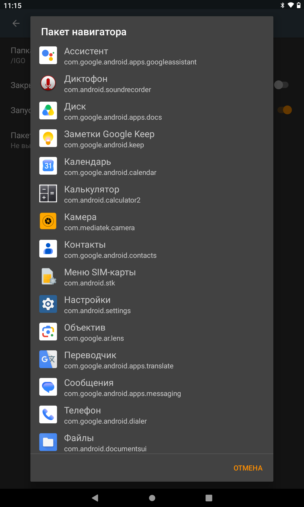

# Смена скина (Skinchange)

Android-приложение, которое одним нажатием переключает скины навигатора **iGO** (Primo, NextGen, Pioneer AVIC и другие сборки). Скинов может быть от 2 до 4, их количество и названия кнопок задаются в `sys.txt`.

> *English:* an Android app that switches between 2–4 iGO navigator skins by renaming the skin folders. The number of skins and the button names come from the `[skin_changer]` section of `sys.txt`. Failed switches are rolled back. Android 5.0+.

## Скриншоты

<table>
  <tr>
    <td align="center"><br>Главный экран</td>
    <td align="center"><br>Настройки</td>
    <td align="center"><br>Выбор навигатора</td>
  </tr>
</table>

## Как это работает

Активный скин лежит в папках `save` и `ux`. Остальные скины ждут своей очереди в папках с номером:

```
IGO/
├── sys.txt         ← количество скинов и названия кнопок
├── save/           ← активный скин, внутри save.ch с текстом skin_1
├── ux/
├── save_2/         ← скин 2, внутри save.ch с текстом skin_2
├── ux_2/
├── save_3/
├── ux_3/
├── save_4/
└── ux_4/
```

Какой скин сейчас включён, приложение узнаёт из файла `save.ch`: в нём записано `skin_1`, `skin_2`, `skin_3` или `skin_4`. У каждого скина свой `save.ch`, и он переезжает вместе с папкой.

При переключении, например, с 1 на 3 папки `save` и `ux` переименовываются в `save_1` и `ux_1`, а `save_3` и `ux_3` становятся `save` и `ux`.

Если `save.ch` лежит не в `save`, а в `ux`, переключается только папка `ux`.

### Настройка в sys.txt

В `sys.txt` в корне папки iGO добавьте раздел `[skin_changer]`:

```ini
[skin_changer]
skin_quantity = 4
skin_1 = "Дневной"
skin_2 = "Ночной"
skin_3 = "Зимний"
skin_4 = "Контрастный"
```

- **`skin_quantity`** — сколько кнопок показать: 2, 3 или 4.
- **`skin_1` … `skin_4`** — надписи на кнопках. Кавычки необязательны. Если названия нет, на кнопке будет «Скин N».
- Остальные разделы `sys.txt` приложение не трогает и не читает.
- Подходят кодировки UTF-8, UTF-16 и Windows-1251.

Если раздела `[skin_changer]` нет, количество кнопок определяется по найденным папкам `save_N` и `ux_N`.

Кнопка включённого скина отмечена «(включён)» и неактивна. Если папок какого-то скина нет, его кнопка тоже неактивна и подписана «(папки не найдены)».

### Безопасность

- **Откат при сбое.** Если какое-то переименование не удалось, уже сделанные шаги отменяются, и папки не остаются переименованными наполовину.
- **Без перезаписи.** Приложение не трогает существующие папки: если папка с нужным именем уже есть, переключение не выполняется.

## Требования

- **Android 5.0 или новее.**
- **Папка iGO, подготовленная для переключения скинов,** — со структурой, описанной выше.

## Установка и настройка

1. Установите APK.
2. Откройте **Настройки → Папка iGO** и выберите папку навигатора — ту, где лежат `sys.txt`, `save` и `ux`.
3. Если нужно, включите:
   - **«Закрывать программу после смены скина»**;
   - **«Запускать iGO после смены скина»** — и выберите пакет своей сборки iGO.
4. На главном экране нажмите кнопку нужного скина.

Меняйте скин, когда iGO закрыт: навигатор читает скин при запуске.

## Сборка

Нужны JDK 17 и Android SDK (платформа 35).

```bash
./gradlew assembleDebug
```

```bash
./gradlew testDebugUnitTest lintDebug
```

APK появится в `app/build/outputs/apk/debug/`. Для release-сборки задайте свою подпись в `app/build.gradle.kts`.

## Что изменилось в 2.1

- **От 2 до 4 скинов** вместо трёх фиксированных; папки и маркеры пронумерованы: `save_2`, `skin_2` и т. д.
- **Количество и названия кнопок** задаются в разделе `[skin_changer]` файла `sys.txt`.
- **Старая схема** с `default_skin`, `pongo_skin`, `alt_skin` и папками `ux_pongo`/`ux_alt` больше не поддерживается: переименуйте папки и маркеры по новой схеме.

## Что изменилось в 2.0

Версия 2.0 полностью переписана на Kotlin под современный Android:

- **Доступ к папке iGO:** через системное окно выбора папки, поэтому всё работает и на Android 10+.
- **Надёжность:** смена скина откатывается при сбое и никогда не перезаписывает существующие папки.
- **Исправлены** падения, когда путь не задан или файл `save.ch` не найден.

Версия 2.0 подписана другим ключом, чем 1.x, поэтому обновить «поверх» не получится: удалите версию 1.x и установите 2.0 заново.

## Лицензия

[MIT](LICENSE)
